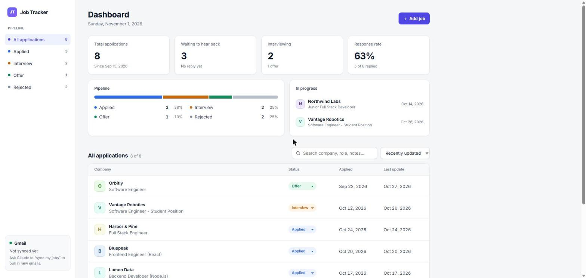

# Job Tracker

A small full-stack app for tracking job applications during a job search: what you applied to, where each one stands, and what happened along the way.



## Features

- Dashboard with totals, response rate, a pipeline bar and a list of active interviews
- Filter by status (Applied, Interview, Offer, Rejected), search, and sort
- Change a status inline; every change is recorded on the job's timeline
- Details panel with notes, job link and history
- Add, edit and delete jobs
- Responsive layout with light and dark mode

## Tech stack

| Part | Tech |
|---|---|
| Frontend | React 19 (function components, hooks), Vite, plain CSS |
| Backend | Node.js, Express 5 |
| Storage | A JSON file on the server |

## How it works

```
React (localhost:5173)  ──fetch /api/jobs──▶  Vite dev proxy  ──▶  Express API (localhost:3001)  ──▶  data/jobs.json
```

- **Frontend:** `App` owns the state (`useState`): the jobs list, the active filter, the search text. It loads data from the API in a `useEffect` and passes data down to child components (`Sidebar`, `Overview`, `JobList`, `JobDrawer`, `JobForm`) through props.
- **Backend:** a REST API:

  | Method | Route | What it does |
  |---|---|---|
  | `GET` | `/api/jobs` | List all jobs |
  | `POST` | `/api/jobs` | Create a job |
  | `PATCH` | `/api/jobs/:id` | Update fields (status changes are added to the timeline) |
  | `DELETE` | `/api/jobs/:id` | Delete a job |

- **Data:** jobs are stored in `server/data/jobs.json`, which is git-ignored. On the first run it's created from `server/sample-jobs.json`.

## Running it

You need Node.js 20 or newer.

```bash
cd server && npm install && npm run dev
```

```bash
cd client && npm install && npm run dev
```

Then open the URL Vite prints (usually http://localhost:5173). On Windows, `start-tracker.cmd` starts both.

## Project structure

```
client/          React app (Vite)
  src/App.jsx    state, data loading, layout
  src/api.js     fetch calls to the API
  src/components Sidebar, Overview, JobList, JobDrawer, JobForm, StatusSelect, Avatar
server/          Express API
  index.js       routes and file storage
  sample-jobs.json
```
